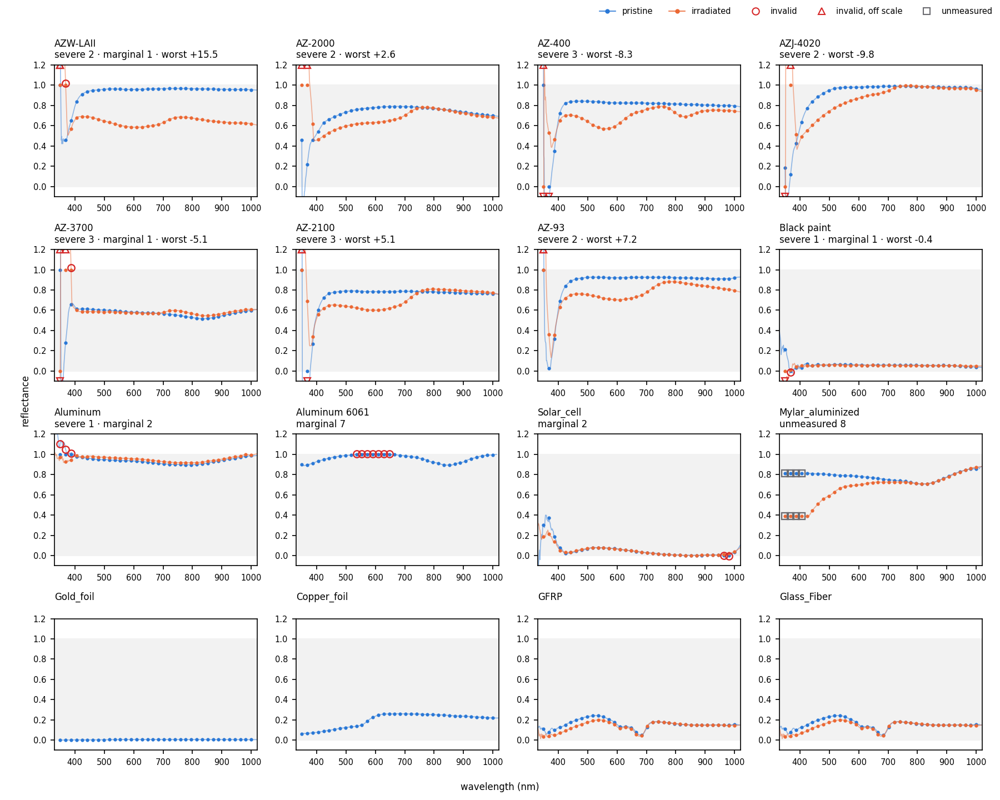

# Material reflectance sheets: anomalies to check

Data: `Bus.xlsx`, `Wings.xlsx`, `antenna.xlsx`, 46 materials (35 with an irradiated spectrum).

## How I handle it currently

1. Grid wavelengths outside material spectrum take the nearest measured value: the first one at the blue end, the last one at the red end.
2. All values are clipped to [0, 1].

## Anomalies within 350–1000 nm

Values as they appear in the sheets (P = pristine, I = irradiated).

| material | state | issue | wavelengths | extreme values | current solution |
|---|---|---|---|---|---|
| AZW-LAII | P / I | far outside [0, 1] at the start of the scan | 350–351 / 350–368 nm | +4.45 / +15.5 | clipped to [0, 1] |
| AZ-2000 | P / I | same | 351–360 / 350–377 nm | −0.66 / +7.72 | clipped to [0, 1] |
| AZ-400 | P / I | same | 350–373 / 350–354 nm | −0.57, +1.75 / −8.30, +1.38 | clipped to [0, 1] |
| AZJ-4020 | P / I | same | 351–364 / 350–377 nm | −0.98 / −9.81, +4.99 | clipped to [0, 1] |
| AZ-3700 | P / I | same | 350–361 / 350–387 nm | −0.50, +1.29 / −5.13, +4.13 | clipped to [0, 1] |
| AZ-2100 | P / I | same | 350–378 / 350–364 nm | −1.82, +2.62 / +5.15 | clipped to [0, 1] |
| AZ-93 | P / I | same | 350–351 / 350–358 nm | +7.21 / +4.27 | clipped to [0, 1] |
| Black paint | P / I | negative at the start of the scan | 368–379 / 351–366 nm | −0.02 / −0.37 | clipped to 0 |
| Aluminum | P | above 1 at the start of the scan | 351–394 nm | +1.14 | clipped to 1 |
| Aluminum 6061 | P | slightly above 1 | 542–631 nm | +1.007 | clipped to 1 |
| Solar_cell | P / I | slightly negative | 885–982 / 854 nm | −0.008 / just below 0 | clipped to 0 |
| Mylar_aluminized | P, I | scan starts at 430.5 nm | 350–430 nm | — | held at the 430.5 nm value |
| Gold_foil | P | suspiciously dark for gold | whole scan | 0.2–0.6 % everywhere; polished gold reflects about 40 % in the blue and over 90 % above 600 nm | none yet; used as measured |
| Copper_foil | P | suspiciously dark, and decreasing into the infrared | whole scan | 6 % at 350 nm, peak 26 % at 700 nm, 12 % at 2400 nm; the `Copper` sheet gives 16–84 %, rising | none yet; used as measured |
| GFRP (antenna), Glass_Fiber (Wings) | P, I | identical data in two sheets | whole scan | — | none yet; kept as two separate materials |

## Questions

2. Are the blue-end values of the AZ coatings, Black paint and Aluminum measurement artifacts? Is clipping to [0, 1] reasonable? I can alternatively crop all of these anomalous values if I start with blue end 390-400 nm.
3. Gold_foil and Copper_foil: they appear suspiciously dark, are they supposed to be like that?
4. GFRP and Glass_Fiber: it's the same material, but in different satellite parts?
